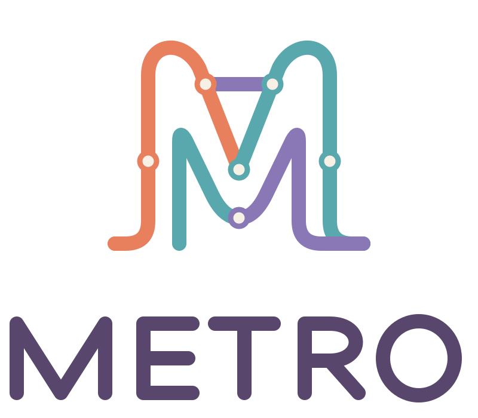
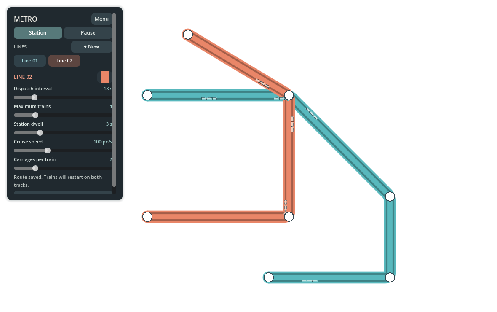
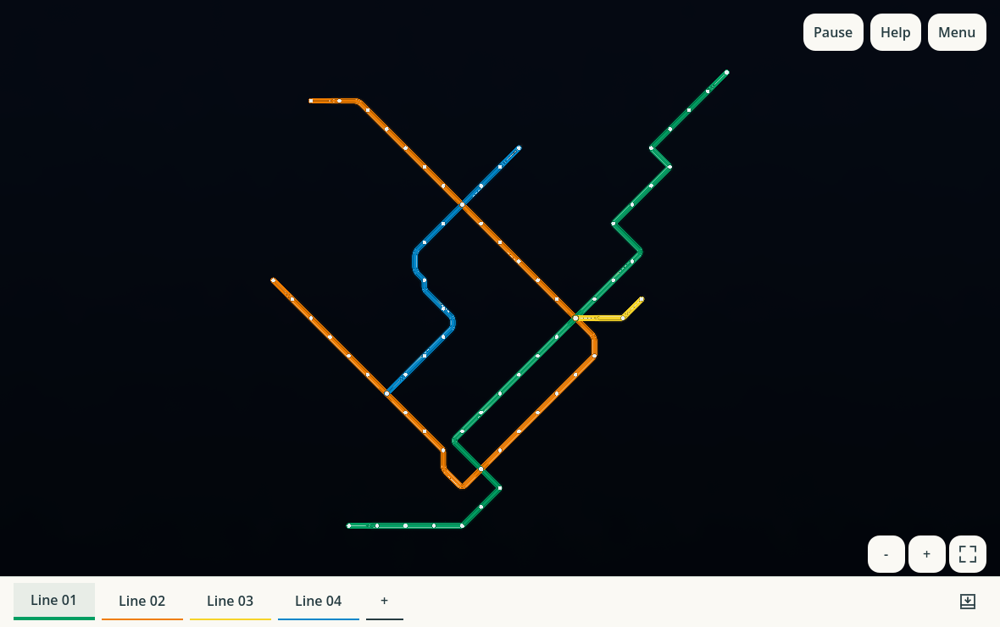

# Metro

Metro est un jeu de création de réseaux de métro au rythme tranquille.
Dessinez des lignes, reliez les stations et observez les trains circuler dans
une ambiance qui évolue du jour à la nuit. Sans objectif imposé ni limite de
temps, chacun peut façonner son réseau à son rythme.

**[Jouer à Metro dans le navigateur](https://muskeg.github.io/metro/)**

| Montréal, le jour | Montréal, la nuit |
| --- | --- |
|  |  |

## Découvrir Metro

Commencez par explorer le réseau proposé, suivre les trains ou apporter vos
propres modifications. Vous pouvez aussi partir d'une carte vide ou découvrir
les réseaux de Montréal et de Tokyo.

Enregistrez vos créations pour les retrouver plus tard, ou partagez-les avec
d'autres personnes.

## En savoir plus

- [Guide de jeu et commandes](docs/guide.md) — aide, cartes, sauvegardes et partage.
- [Développement](docs/guide.md#développement) — lancer le projet et les vérifications.
- [Décisions de conception](DESIGN.md) — l'esprit et les choix du projet.
