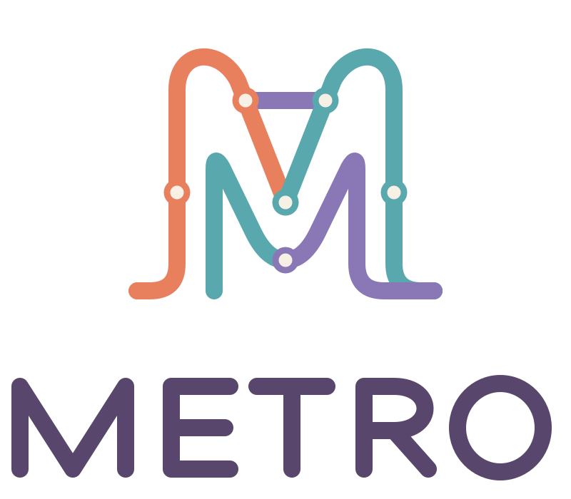
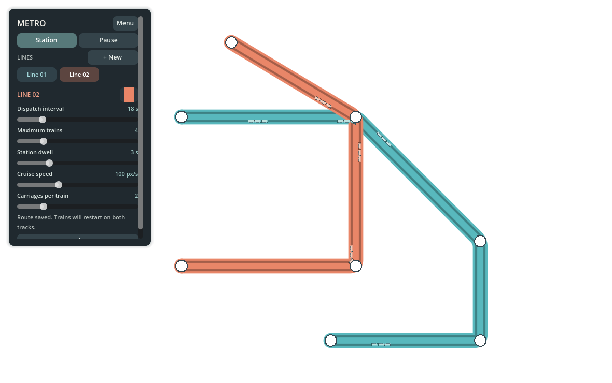
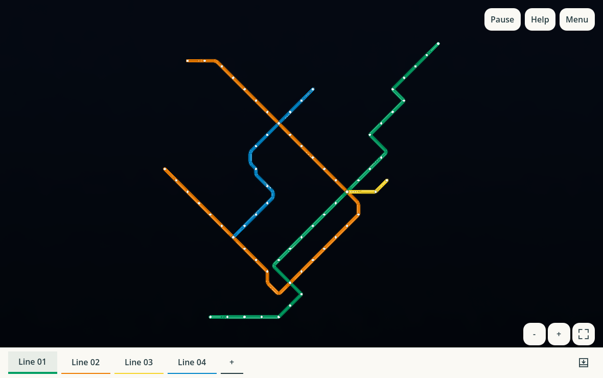
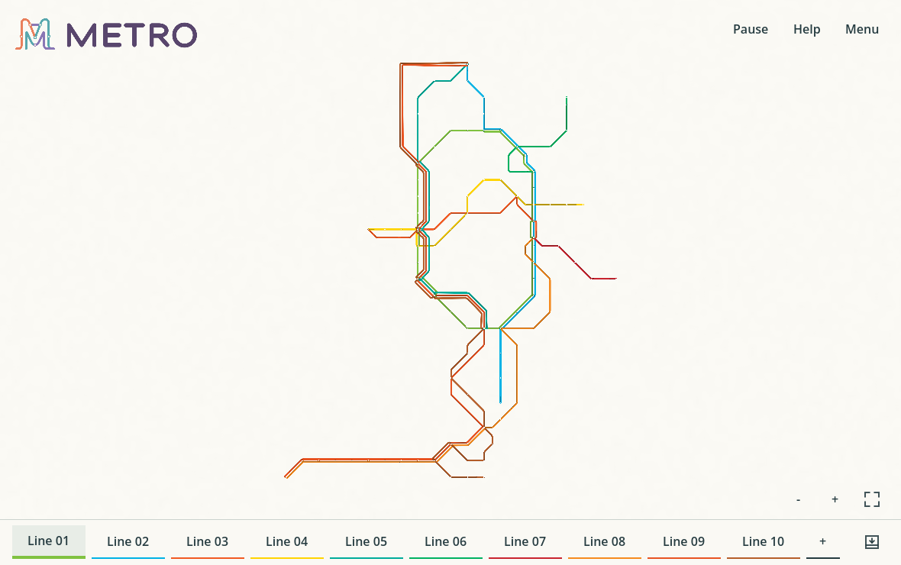
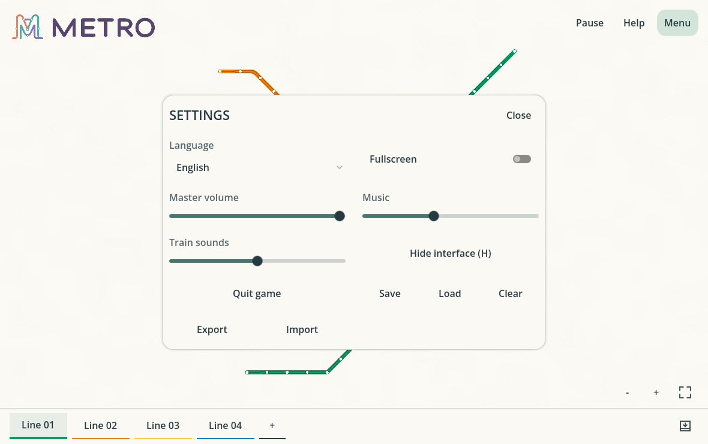

# Metro



Dessinez un réseau de métro, regardez les rames circuler, prenez votre temps.
Pas de budget, pas d'objectifs imposés : des lignes colorées, une ambiance
jour/nuit et une musique lo-fi originale.

**[Jouer dans le navigateur](https://muskeg.github.io/metro/)** ·
[Commandes](#commandes) · [Développement](#développement) ·
[Déploiement](#github-pages)

| Montréal — jour | Montréal — nuit |
| --- | --- |
|  |  |

## Pour commencer

Sur Windows et macOS, le jeu s'ouvre sur **Metro demo** : trois lignes, une boucle et des
correspondances, avec des trains déjà prêts à circuler. La version Web publiée
sur GitHub Pages s'ouvre sur **Montréal métro**, avec ses 68 stations.
Modifiez ce réseau et
enregistrez votre copie, ou utilisez **Menu → Clear** pour partir d'une carte
vide. **Menu → Load → Metro demo (included)** retrouve toujours l'original.
Ce réseau est inclus dans chaque release et ne dépend pas du stockage local ;
vos sauvegardes ne peuvent pas le remplacer, même avec le même nom.
Au démarrage et à chaque chargement, le réseau est centré et agrandi pour
remplir la fenêtre disponible, sans couper les stations ou les coudes.
Une petite marge garde les commandes accessibles ; les proportions sont conservées.
Les boutons **− / + / ajuster** au-dessus du rail des lignes permettent de
dézoomer, zoomer et retrouver le réseau complet après déplacement. Ajuster
arrête le suivi d'une rame sans interrompre ni redémarrer les trains.

### Réseaux réels inclus

**Menu → Load** propose aussi des schémas originaux fondés sur les stations,
liaisons et correspondances de cartes ferroviaires publiques. Les noms de
stations apparaissent au survol ; ceux des services sont visibles dans leurs
réglages et les infobulles des onglets. Tokyo démarre avec un maximum de
**deux trains par parcours** ; Montréal avec **six par ligne, sauf deux sur
la jaune**. Toutes ces lignes utilisent des trains à deux wagons.
Enregistrez une copie pour conserver vos modifications. Le petit réseau de
démonstration reste celui du démarrage sur desktop et reste disponible dans Load sur le Web.

- **Tokyo JR central** : remplace le grand preset régional par un schéma
  de Tokyo et de ses branches Shōnan : 80 stations, 97 voies physiques et
  dix parcours. La boucle verte Yamanote comprend
  ses 30 stations, dont Takanawa Gateway ; Shinjuku est à l'ouest, Ikebukuro
  au nord et Shinagawa au sud. Les lignes Chūō rapide et Chūō–Sōbu locale
  traversent son centre. Inclut aussi Keihin-Tōhoku (Akabane–Kamata, arrêts
  locaux), Saikyō (Akabane–Ōsaki), Jōban rapide (Ueno–Kita-Senju) et
  Keiyō locale (Tokyo–Shin-Kiba).
  La **Tōkaidō-sen** relie Tokyo à Odawara via Kawasaki, Yokohama, Ōfuna,
  Fujisawa, Chigasaki et **Hiratsuka**, avec les 16 arrêts locaux.
  **Shōnan–Shinjuku** comporte deux parcours depuis Akabane via Ikebukuro,
  Shinjuku et Shibuya : rapide vers Odawara et local vers Zushi via Kamakura.
  Le rapide (pas le « special rapid ») dessert tous les arrêts Tōkaidō au
  sud de Totsuka ; le local dessert aussi Nishi-Ōi, Shin-Kawasaki, Hodogaya
  et Higashi-Totsuka. Chaque parcours reste limité initialement à deux trains.
  Les extrémités indiquent les limites du
  preset, pas nécessairement les vrais terminus. Aucun métro Tokyo Metro/Toei,
  réseau régional lointain ou liaison aéroport n'est inclus. Références :
  [carte ferroviaire JR East](https://www.jreast.co.jp/e/info/map_a4ol.pdf).
  Les séquences et arrêts ont été recoupés avec les tableaux publics des
  lignes référencés dans le JSON et le générateur.
  Références pour les extensions :
  [Tōkaidō JR East](https://en.wikipedia.org/wiki/T%C5%8Dkaid%C5%8D_Line_(JR_East)) et
  [Shōnan–Shinjuku](https://en.wikipedia.org/wiki/Sh%C5%8Dnan%E2%80%93Shinjuku_Line).
  Les services partageant une voie sont présentés côte à côte, avec un espace
  entre leurs bandes ; les trains suivent ces mêmes corridors séparés.
- **Montréal métro** : les 68 stations des lignes verte (27), orange (31),
  jaune (3) et bleue (12), avec leurs correspondances partagées :
  68 stations, 69 voies physiques, quatre parcours et 20 trains :
  six sur la verte, l'orange et la bleue, deux sur la jaune.
  Le preset contient uniquement le métro existant, sans REM, exo, bus,
  extrémités de continuation ni extensions projetées.
  Son schéma conserve les repères visuels du réseau : diagonale nord de
  l'orange, retour en U au sud-ouest, axe vert du centre-ville, décrochements
  de la verte au nord-est et de la bleue, branche jaune vers l'est.
  Les stations et les coudes sont espacés plus étroitement, sans changer
  la forme du schéma. Les sections les plus courtes de la queue ouest gardent
  davantage de place pour les trains à deux wagons.
  Les segments droits utilisent le plus petit espacement valide sur la grille ;
  les coudes caractéristiques et la place nécessaire aux deux trains de la jaune
  sont conservés. Les flottes se mettent en service progressivement au chargement.
  Référence : PDF STM fourni (10-2025) et
  [cartes du réseau STM](https://www.stm.info/en/network-guide/all-stm-network-maps).

Les tracés ne reproduisent pas les illustrations des opérateurs et ne sont pas
géoréférencés. Ces presets ne constituent ni un planificateur de trajet ni des
horaires officiels.
Les plafonds de trains sont des réglages initiaux modifiables, pas une
restriction de l'éditeur ; la capacité géométrique peut réduire la flotte.
Les grands réseaux demandent davantage de calcul que la démo, notamment pour
la circulation et les corridors partagés. Les temps des tests sont consignés
dans [MEMORY.md](../MEMORY.md), pas des garanties de performances ou de FPS.



### Construire et modifier

1. Survolez la carte : une station fantôme indique où un clic la placera.
2. Survolez une station et glissez son **+** vers une autre pour les relier.
   Le **+** reste accessible au-dessus d'un rail existant, même pour partir
   dans la direction opposée.
3. Les trains partent dans les deux sens. Réglez leur fréquence, leur vitesse
   et leurs wagons en cliquant sur leur ligne dans le bandeau du bas.
4. Ajoutez une ligne avec **+**, juste après les boutons de lignes dans ce bandeau,
   ou reliez les extrémités d'une ligne
   d'au moins trois stations pour former une boucle.

**Menu → Language** permet de passer de l'anglais au français. Le menu propose
aussi les volumes, le plein écran et la sortie du jeu.
**Menu → Save / Load / Clear** permet d'enregistrer plusieurs
réseaux nommés, de les retrouver et de repartir d'une carte vide. Charger, vider
ou remplacer une sauvegarde demande confirmation ; vider ne supprime pas les
réseaux enregistrés. Les modifications ne sont pas sauvegardées automatiquement.

Les sauvegardes conservent stations, coudes, voies partagées, boucles, couleurs,
réglages des lignes et cadrage. Au chargement, le cadrage enregistré est remplacé
par un ajustement automatique à la fenêtre actuelle. Les rames repartent normalement au chargement ;
la pause et l'ambiance courante sont conservées.
Le stockage local utilise des fichiers JSON versionnés dans `user://layouts` :
`%APPDATA%\Godot\app_userdata\Metro\layouts` sous Windows,
`~/Library/Application Support/Godot/app_userdata/Metro/layouts` sous macOS,
et IndexedDB dans le navigateur. Aucun compte ni serveur n'est nécessaire.
Les noms sont limités à 64 caractères et chaque fichier à 16 Mio.
Les sauvegardes ne se synchronisent pas entre appareils ou navigateurs.

### Partager un réseau

**Menu → Export** exporte la carte actuelle (preset inclus ou carte modifiée)
dans un fichier JSON portable. Sur Windows/macOS, choisissez sa destination ;
sur le Web, le navigateur télécharge `Metro-layout.json`. Envoyez ce fichier
à un autre joueur, puis utilisez **Menu → Import** pour le sélectionner.
Une confirmation précède le remplacement ; annuler ou fournir un fichier
invalide laisse la carte intacte. Le réseau importé est cadré automatiquement.
**Save** conserve ensuite une copie locale sous le nom de votre choix ;
l'importation ne remplace aucune sauvegarde existante.

Les fichiers sont uniquement des données : aucun script, ressource externe,
chemin de sauvegarde ou HTML fourni dans le JSON n'est exécuté ou chargé.
Le même validateur protège les imports et sauvegardes. Limites de sécurité :
16 Mio, 256 stations, 512 voies, 16 lignes, 64 trains maximum au total,
32 waypoints par voie / 2 048 au total, 512 points par ligne / 4 096
points de service cumulés, 2 048 appels de station et 200 000 unités de longueur
de voies/service. Coordonnées limitées à ±48 000 et grille exacte ; JSON UTF-8
avec au plus 16 niveaux, 32 768 jetons structurels et 4 096 octets par chaîne.
Les jetons numériques sont limités à 128 octets.
Les références, couleurs, noms, réglages, positions distinctes, tracés sans
retour/croisement propre et dégagements des trains/stations sont vérifiés avant
l'installation. Les croisements entre voies indépendantes restent autorisés.
Ces limites réduisent aussi les risques de blocage par données excessives ;
elles ne constituent pas une garantie contre tout défaut du moteur/navigateur.



### Interface

Sur le Web, autorisez les données du site et évitez la navigation privée :
effacer ces données efface les réseaux enregistrés, et le navigateur peut
évincer son stockage. Un avertissement apparaît si Godot détecte que le stockage
n'est pas persistant ; cette détection ne garantit pas sa conservation.
Les commandes restent lisibles sur écran Retina et dans le navigateur.
Les réglages et l'aide s'ouvrent à la demande ; **Close / Échap** les referme
sans interrompre le réseau.
Ces panneaux sont centrés sur l'écran ; tous les réglages restent visibles
sans barre de défilement. Le titre Metro commence à disparaître après
10 secondes et s'efface complètement à 30 secondes, sans revenir.
Son grand format évoque un titre d'ouverture plutôt qu'un élément du menu.
Les lignes occupent un rail fin sur toute la largeur du bas. Leurs réglages
se déplient directement dans ce rail ; toucher à nouveau la ligne les referme.
Le bouton **Collapse** en haut des réglages reste accessible pendant le
défilement. **Line color** indique la pastille cliquable qui ouvre le sélecteur.
**Delete line** demande confirmation avant de retirer la ligne, ses trains
et ses voies/stations exclusives ; l'infrastructure partagée est conservée.
Supprimer la dernière ligne laisse une ligne vide prête à être dessinée.
Le bouton de repli utilise une icône de panneau avec une flèche descendante,
sans texte. Une fois replié, la même icône avec une flèche montante permet
de rouvrir le rail au même endroit, en bas à droite, pour pouvoir cliquer
deux fois sans déplacer le pointeur.
Après huit secondes sans activité,
les commandes s'estompent doucement. Un mouvement ou un toucher les réveille ;
les menus ouverts et les gestes en cours restent visibles.

## Commandes

| Action | Geste |
| --- | --- |
| Déplacer la vue | Glisser à deux doigts ; clic milieu ou Espace + glisser |
| Zoomer | Boutons **− / +**, pincement sur le trackpad ou molette |
| Ajuster le réseau à la fenêtre | Bouton à quatre coins au-dessus du bandeau des lignes |
| Placer une station | Cliquer sur un espace libre, à l'emplacement de l'aperçu |
| Déplacer une station | Glisser son centre |
| Dessiner par étapes | Cliquer sur **+**, fixer des coudes, terminer sur une station |
| Inverser le coude / retirer le dernier | Tab / Retour arrière |
| Remodeler un rail | Glisser un losange au survol |
| Insérer une station | Cliquer sur un rail ou son **+** |
| Supprimer | **×** au survol ou Suppr, puis confirmer |
| Supprimer une ligne | Réglages de la ligne → **Delete line**, puis confirmer |
| Sauvegarder / charger / vider | **Menu → Save / Load / Clear** |
| Partager un réseau | **Menu → Export / Import** (fichier JSON) |
| Suivre un train | Cliquer sur une motrice ou un wagon |
| Annuler / arrêter le suivi | Échap ; déplacer la vue arrête aussi le suivi |
| Pause / plein écran | P / F11 |
| Regarder sans interface | H ou **Menu → Hide interface** ; toucher la poignée en bas, H ou Échap pour revenir |

Le remodelage ne change que la section choisie, entre deux points d'ancrage fixes
indiqués par de petits cercles. Les autres coudes restent en place. Les poignées
se placent à côté du rail, même sur une section courte ou verticale. Le point
déplacé suit la grille ; un aperçu rouge explique le blocage près du curseur.

Sans interface, le réseau continue de vivre : déplacez la vue, zoomez ou suivez
une rame sans risquer de modifier la carte. La pause existante est conservée.
La carte n'a pas de bord fixe. Le dézoom manuel descend normalement à **0,08×** ;
si l'ajustement d'un grand réseau exige une échelle plus petite, cette échelle
devient le minimum de navigation. Après redimensionnement, utilisez le bouton
d'ajustement pour recadrer sans perdre vos déplacements manuels.
Les presets inclus sont modifiables ; l'import partage des réseaux Metro,
pas des données géographiques ou des cartes d'opérateurs.
La poignée discrète conserve une grande zone tactile, même sans clavier sur téléphone.
Le suivi d'une rame masque aussi les aperçus et poignées d'édition ; les clics
sur la carte ne la modifient pas. Échap ou déplacer la vue rend l'édition.

**Aide** dans le jeu rappelle les gestes. Supprimer une station reconnecte ses
voisins sur chaque ligne en conservant le tracé. Le **×** au survol d'un rail
(même près d'un coude) supprime la voie et sépare les lignes. Les suppressions
demandent confirmation. Une voie déjà présente entre les voisins est réutilisée ;
une boucle reste fermée tant qu'il reste au moins trois stations.
Les virages conservent leurs coudes serrés d'origine, avec un arrondi local ;
les stations restent sur la grille, sans élargir les courbes pour les centrer.
Les voies peuvent se croiser hors station sans correspondance ni conflit
entre lignes. Utilisez une station commune pour créer une correspondance ;
un tracé ne peut toujours pas se croiser lui-même ni revenir sur ses pas.
L'aide est une fiche courte. Les actions réussies restent silencieuses :
la carte montre le résultat. Avant la première liaison, un **+** discret
suggère le geste ; pendant le tracé, les destinations valides sont entourées.
Seules les erreurs demandant une action affichent un message.
Les stations reprennent la couleur assombrie de leur ligne. Aux correspondances,
les lignes ajoutées forment des anneaux concentriques de 2 pixels ; le centre
blanc grandit de 1 pixel de rayon par ligne supplémentaire. Le rayon total
passe de 12 pixels pour une ligne à 15 pour deux et 18 pour trois.
Les marqueurs restent opaques : les rames passent naturellement dessous.

### Une circulation régulière

Chaque ligne et chaque sens circulent indépendamment, même aux correspondances.
Plusieurs rames peuvent circuler entre deux stations : leur freinage conserve
une distance sûre. De courtes attentes en station et de petits ajustements de
vitesse corrigent les écarts ; les terminus offrent un temps de récupération.
Aux terminus, les deux voies convergent vers une courte voie commune :
la rame s'arrête, change de cabine puis rejoint la voie de retour.
Une seule rame peut occuper ce raccord à la fois ; aucune voiture ne glisse
latéralement ni ne fait un demi-tour serré. Les boucles ne changent pas.
La cabine s'arrête légèrement avant le marqueur du terminus : la rame et son
quai restent dehors, sans être masqués par le cercle.
Ce retrait s'applique aussi aux arrêts intermédiaires et aux boucles, dans les
deux sens. En mouvement, les trains passent toujours sous les stations.
L'approche des quais freine progressivement sans longue fin de parcours au ralenti,
tout en conservant la marge de sécurité derrière les autres rames.
Les rames ont des cabines aux deux extrémités et des toits métalliques clairs.
Les voitures sont plus élancées : 50 % plus longues, sans élargir les caisses.
Leur longueur réelle détermine les espacements et la capacité de la ligne.
La nuit devient très sombre ; rails lumineux et halos de phares guident le regard.
Le fond évoque une surface mate légèrement texturée, plutôt qu'une table en verre.
L'aube bleutée, le coucher pêche et l'heure bleue encadrent un midi blanc cassé.
Les voies et les rames projettent des ombres discrètes : courtes à midi,
plus longues et de directions opposées au lever/coucher, absentes au milieu de la nuit.
Les stations ne projettent pas d'ombre. Une source lumineuse traverse la vue
de gauche à droite ; l'ombre du tracé complet passe du côté droit au côté gauche.
Les courbes sont subdivisées selon leur courbure pour rester lisses en gros plan.
Aux stations partagées, l'illumination des rails s'interrompt autour du raccord
pour ne pas souligner les superpositions en croix.
Les contrôles restent contrastés et s'estompent moins qu'en plein jour.
En zoom rapproché, portes doubles, ventilation et soufflets articulés se révèlent ;
à l'échelle de la carte, leur silhouette reste sobre.
Lors d'un arrêt en vue rapprochée, un quai continu apparaît le long de la rame.
Sa bordure tactile et ses joints dessinent un petit quai en béton. Les voyageurs,
plus nombreux et plus petits, attendent en groupes irréguliers et suivent des
petits trajets à des rythmes différents, toujours contenus sur le quai.
Ils utilisent aussi la largeur du quai : les sortants poursuivent leur marche
après la descente, et les entrants s'approchent plus tôt, sans prolonger l'arrêt.
Le quai et sa bande tactile suivent une courbe douce dans les virages, sans
marches entre les voitures ni modification du tracé des rails.
Les voitures et cabines sont légèrement plus longues ; leurs proportions et
les espacements restent cohérents. Les halos nocturnes ont des raccords arrondis,
sans coins lumineux carrés.
Le halo garde une largeur régulière dans les virages ; ses contours fusionnés
évitent les replis lumineux à l'intérieur des courbes.
Sa forme suit les voitures même dans les courbes, sans imposer de zones droites
ni modifier les coudes que vous dessinez. Les trains restent visibles.
Des voyageurs descendent puis montent ; ceux qui partent s'effacent sur le quai,
sans courir au loin. Leur vitesse reste limitée, même pendant les arrêts courts.
Les quais s'effacent au départ. L'embarquement peut prolonger l'arrêt minimum de
deux secondes au plus, même quand la vue est dézoomée. Aucun objectif de fréquentation.

**Intervalle minimum** fixe la fréquence souhaitée. Le maximum de rames reste
réglable, plafonné par la capacité du trajet plutôt que par le nombre de stations.
Survolez ce réglage pour voir la flotte conseillée selon le temps de parcours.
Les rames excédentaires quittent le service au terminus, ou à l'origine d'une boucle.
Les chemins qui convergent en station peuvent se superposer visuellement sans
bloquer les autres lignes ou l'autre sens.

## Développement

Projet Godot 4 / GDScript, vérifié avec **Godot 4.7.2**, moteur **Compatibility**.
Ouvrez [project.godot](../project.godot) dans Godot et appuyez sur **F6** depuis
la scène principale, ou **F5** pour lancer le projet.

Les commandes ci-dessous supposent que `godot` est accessible dans le terminal.
Sur macOS, utilisez au besoin `/Applications/Godot.app/Contents/MacOS/Godot`.
Installez les modèles d'export **de la même version** depuis
**Editor → Manage Export Templates**.

### Exporter

```sh
mkdir -p dist/web
godot --headless --editor --path . --quit
godot --headless --path . --export-release "Windows Desktop" dist/Metro.exe
godot --headless --path . --export-release "macOS" dist/Metro-macOS.zip
godot --headless --path . --export-release "Web" dist/web/index.html
```

- **Windows** : exécutable x86_64 autonome.
- **macOS** : ZIP contenant une app universelle Intel / Apple Silicon, signée
  ad hoc, non notariée. Gatekeeper peut demander **Ouvrir quand même** dans
  **Réglages Système → Confidentialité et sécurité**.
- **Web** : sans threads, compatible avec GitHub Pages sans en-têtes spéciaux.
  Pour l'essayer : `python3 -m http.server 8000 --directory dist/web`, puis
  ouvrez `http://localhost:8000/`. Un premier clic peut être nécessaire pour le son.
  La musique générée utilise le mode audio Stream dans le navigateur.

Les tests, captures de documentation et exports précédents sont exclus des
builds. Gardez l'import ETC2/ASTC activé pour les exports ARM64.

### Vérifier

```sh
godot --headless --path . --script res://tests/simulation_smoke.gd
godot --headless --path . --script res://tests/schedule_smoke.gd
godot --headless --path . --script res://tests/interface_smoke.gd
godot --headless --path . --script res://tests/branding_smoke.gd
godot --headless --path . --script res://tests/localization_smoke.gd
godot --headless --path . --script res://tests/layout_smoke.gd
godot --headless --path . --script res://tests/transfer_smoke.gd
godot --headless --path . --script res://tests/preset_smoke.gd
godot --headless --path . --script res://tests/audio_smoke.gd
godot --path . --script res://tests/visual_smoke.gd --audio-driver Dummy
```

Le test visuel nécessite un écran. La liste complète des validations et les
derniers résultats figurent dans [MEMORY.md](../MEMORY.md#validation-and-delivery).

### Logo et captures

Le logo reprend un **M de lignes et de correspondances** en orange, turquoise
et violet. Les [sources SVG](../assets/branding/metro-logo.svg) sont autonomes,
sans police ni image externe. Le symbole et le mot-symbole servent au titre
qui disparaît progressivement, aux icônes Windows/macOS, au favicon, à
l'icône tactile Web et à l'écran de chargement.

Après modification du [symbole](../assets/branding/metro-mark.svg) ou du
[mot-symbole](../assets/branding/metro-wordmark.svg), régénérez les variantes,
puis importez le projet avant d'exporter :

```sh
godot --headless --path . --script res://scripts/tools/build_branding.gd
godot --headless --editor --path . --quit
```

Les PNG générés restent dans le dépôt : aucun outil graphique supplémentaire
n'est requis pour les exports. Les captures ci-dessus proviennent du jeu
actuel à 1180 × 740 ; pour les actualiser (un écran est nécessaire) :

```sh
godot --path . --script res://scripts/tools/capture_readme.gd --audio-driver Dummy
```

## GitHub Pages

Le workflow [pages.yml](../.github/workflows/pages.yml) :

- vérifie simulation, horaires, terminus, audio, interface, logo, traductions,
  sauvegardes, partage et presets, puis exporte le Web sur les PR vers `main` ;
- publie `dist/web/` à chaque push sur `main` ;
- peut être relancé avec **Actions → Build and deploy Metro to Pages →
  Run workflow**, sur `main`.

Dans **Settings → Pages**, choisissez **GitHub Actions** comme source.
Le preset d'export Web porte la feature `montreal_startup` : chaque ouverture
du site charge le réseau Montréal inclus, sans modifier ni charger automatiquement
les sauvegardes locales. Les exports Windows/macOS conservent Metro demo.
L'URL du site et le résultat de chaque publication apparaissent dans le
déploiement GitHub Actions. Un commit local seul ne publie pas le site :
il faut le pousser sur `main` ou lancer le workflow.

## Repères du projet

- [scripts/](../scripts/) : interaction, simulation, rendu et audio.
- [tests/](../tests/) : tests de simulation, d'interface et de rendu.
- [translations/ui.csv](../translations/ui.csv) : textes anglais et français.
- [layouts/](../layouts/) : démo et presets versionnés, inclus dans les releases.
- [assets/branding/](../assets/branding/) : logo et icônes SVG/PNG.
- [DESIGN.md](../DESIGN.md) : décisions de conception et détails techniques.
- [AGENTS.md](../AGENTS.md) et [MEMORY.md](../MEMORY.md) : workflow et contexte des agents.
